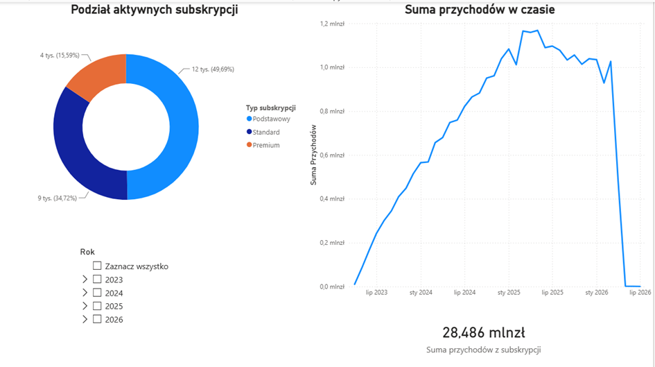
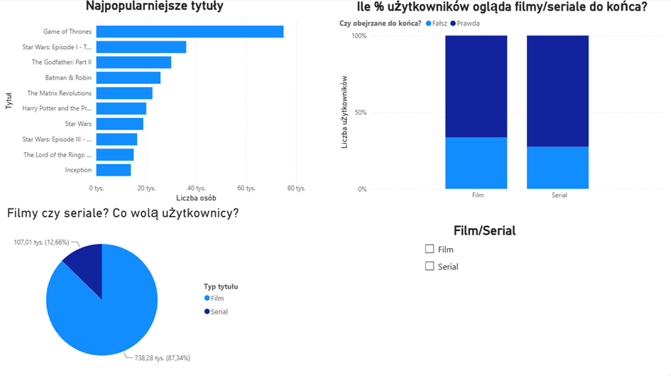
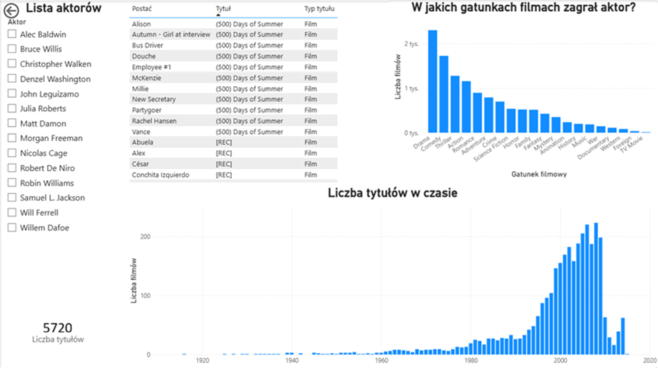

# Platforma streamingowa VOD – baza danych, ETL i raport Power BI

Projekt relacyjnej bazy danych dla serwisu VOD (na wzór Netflix): od modelu danych, przez proces ETL i dane syntetyczne, po raport analityczny w Power BI.
Praca przejściowa na kierunku Zarządzanie i Inżynieria Produkcji (spec. Informatyczne Systemy Zarządzania), Politechnika Warszawska, 2026 – ocena 4,5.

## Najważniejsze liczby
| | |
|---|---|
| Tabele w bazie | 25+ (model w 3NF) |
| Filmy z Kaggle (TMDB 5000) | ok. 4 800 |
| Seriale z IMDb | 3 000 najwyżej ocenianych |
| Syntetyczne konta użytkowników | 50 000 |
| Sesje oglądania | ponad 845 tys. |
| Procedury składowane | 5 |
| Strony raportu Power BI | 3 |

## Architektura
```
Kaggle (CSV) ─┐                         ┌─> Tytuły, Osoby, Gatunki, Sezony, Odcinki
              ├─> SSIS ─> tabele Staging ─> Execute SQL Tasks ─┤
IMDb (TSV) ───┘                         └─> tabele łączące (Tytuly_Aktorzy, Tytuly_Rezyserzy, ...)
Python + Faker ─> pyodbc ─> Użytkownicy, Profile, Subskrypcje, Faktury, Historia_Ogladania
SQL Server ─> Power BI (Import, DAX) ─> raport: Przychody · Top filmów · Aktorzy
```

## Technologie
MS SQL Server 2022 (T-SQL) · SSMS · SSIS (Visual Studio, SSDT) · Python (Faker, pyodbc) · Power BI (Power Query, DAX)

## Model danych


Obszary: użytkownicy i subskrypcje (CRM + finanse), profile, katalog treści, aktywność użytkowników. Relacje wiele-do-wielu (tytuły ↔ osoby, tytuły ↔ gatunki) przez tabele łączące; jedna tabela `Osoby` dla aktorów i reżyserów, bez dublowania danych. Hasła przechowywane wyłącznie jako skrót (`haslo_hash`), ograniczenia `CHECK`, `UNIQUE`, `DEFAULT`.

## ETL (SSIS)
1. **Staging** – surowe pliki CSV/TSV ładowane bez przekształceń (Flat File Source → OLE DB Destination).
2. **Transformacja** – Execute SQL Tasks: słowniki, osoby, tytuły, tabele łączące; parsowanie kolumn JSON (`OPENJSON`), obsługa `NULL` i znaków `\N`, mapowanie identyfikatorów zewnętrznych na klucze wewnętrzne.
3. **Seriale IMDb** – wybór 3 000 najwyżej ocenianych tytułów (`JOIN` z ocenami), sezony i odcinki.

## Dane syntetyczne (Python)
Skrypt generuje spójne dane dla 50 000 kont: profile, subskrypcje, faktury i historię oglądania z rozkładami prawdopodobieństwa. Dane są ładowane wsadowo (`executemany`, paczki po 5 000 rekordów).

## Procedury składowane
| Procedura | Co robi |
|---|---|
| `sp_DodajUzytkownika` | zakłada konto, aktywuje domyślną subskrypcję i tworzy profil |
| `sp_AktywujSubskrypcje` | aktywuje plan abonamentowy |
| `sp_PobierzRekomendacje` | zwraca rekomendacje dla profilu |
| `sp_ZapisDoCzasOgladania` | aktualizuje postęp oglądania |
| `sp_WygenerujFakture` | wystawia fakturę za subskrypcję |

## Raport Power BI
- **Przychody** – przychody miesięczne w czasie, rozkład planów (Podstawowy 49,7% · Standard 34,7% · Premium 15,6%).
- **Top filmów** – ranking tytułów wg unikalnych widzów; filmy to 87% sesji oglądania; odsetek obejrzeń do końca.
- **Aktorzy** – interaktywna filmografia, gatunki i liczba tytułów w czasie.

Miary DAX: `CALCULATE`, `COUNTROWS`, `DISTINCTCOUNT`, `SUM`.





## Zawartość repozytorium
```
schema.sql            – DDL: tabele, klucze, ograniczenia
diagram.png           – diagram ERD
```
