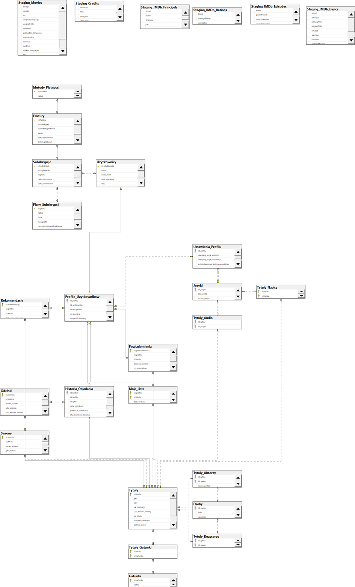

# Baza Danych Platformy Streamingowej (VOD)

Projekt akademicki przedstawiający architekturę relacyjnej bazy danych dla serwisu streamingowego typu Netflix, stworzony w środowisku MS SQL Server.

## Cel projektu
Celem projektu było zaprojektowanie logicznej i zoptymalizowanej struktury danych, która potrafi obsłużyć użytkowników, zarządzanie subskrypcjami, historię oglądania, płatności oraz system rekomendacji.

## Diagram Bazy Danych (ERD)

## Wykorzystane technologie
* **MS SQL Server / T-SQL**
* Normalizacja bazy danych
* Relacje (Klucze Główne i Obce)

## Zawartość repozytorium
* `schema.sql` - skrypty DDL tworzące strukturę bazy danych (tabele, relacje).
* `query.sql` - przykładowe zapytania (DML) analizujące dane (np. wyszukiwanie wygasających subskrypcji, najpopularniejsze filmy).
